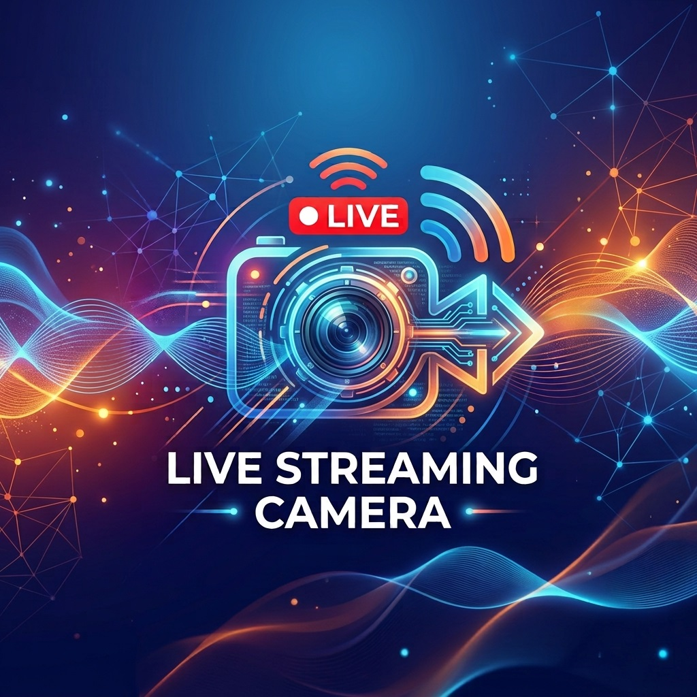

<h1>Live Streaming Camera 1.0</h1>
  
一個中文 Android 直播程式。

 

 

---

## 功能

- ✔️ 推流直播。
- ✔️ 電池資訊、溫度顯示，可設定開關。
- ✔️ Wifi、Sim卡訊號顯示，可設定開關。

---

## 我製作的其他程式
- [Chat Overlay](https://github.com/masarujp2022/Chat-Overlay)：一個Android透明Youtube/Twitch聊天室overlay給直播使用。
